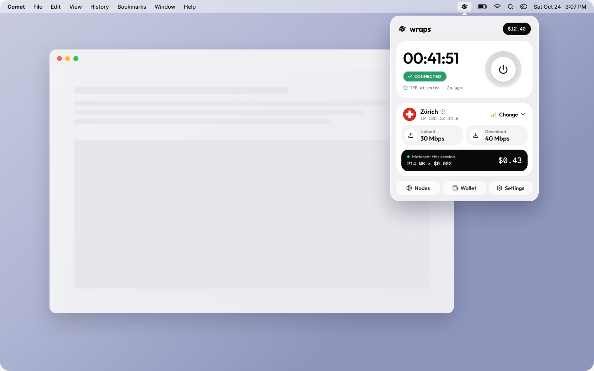
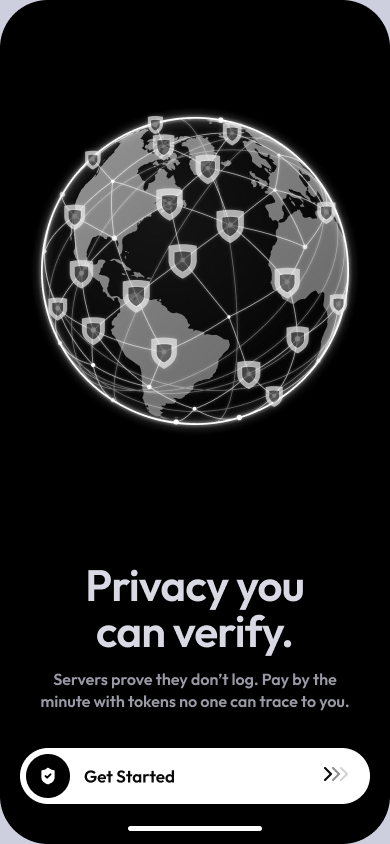
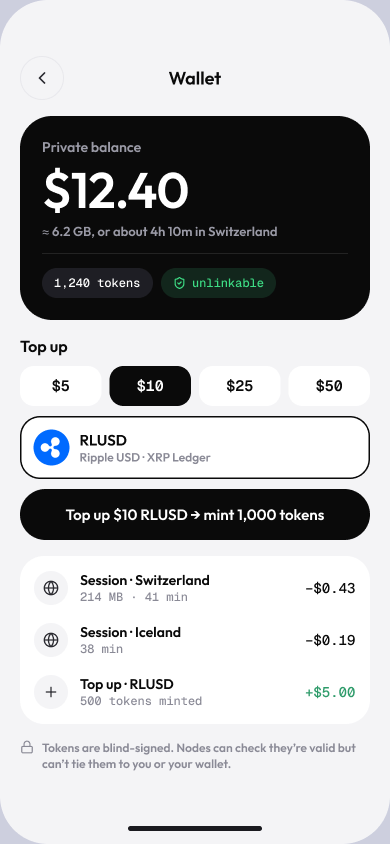
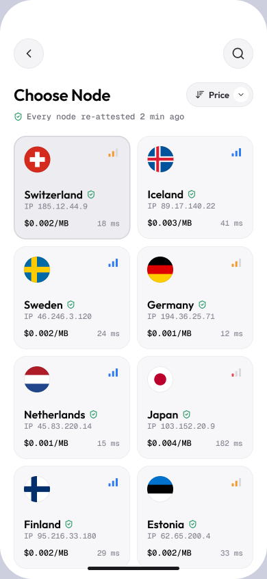
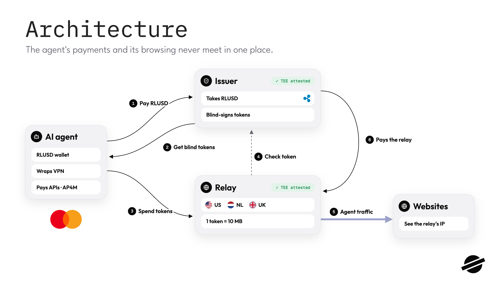

# wraps: incognito mode for agents

**AI agents pay for data with x402, and every payment is public forever. Wraps lets them pay without being watched.**

[](docs/SPEC.md)
[-4285F4)](infra/gcp/STATUS.md)
[](https://www.rfc-editor.org/rfc/rfc9578)
[](https://explorer.testnet.xrplevm.org)
[](#license)

**[Website](https://hrishabhayush.github.io/wraps/)** · **[Download for Mac (v0.1.0)](https://github.com/hrishabhayush/wraps/releases/tag/v0.1.0)** · **[What we can prove](docs/HIGHLIGHTS.md)**

<p align="center">
  
  <br><sub>Design concept of the menu bar app. Node names and rates are illustrative.</sub>
</p>

## The 30-second pitch

**What it is.** Wraps is a confidential payment layer for x402 agents on XRPL. Agents buy blind tokens with RLUSD, then spend them at merchants through an attested relay.

**Who it is for.** Anyone whose agent buys data per call. Example: a fund analyst whose research agent pays crypto data APIs.

**Why it matters.** An x402 payment puts the payer wallet, merchant, amount and exact time on a public ledger. Wallet trackers label fund wallets, so each payment is a line on a public card statement. Wraps splits the work into three layers, and no single party sees both **who** pays and **what** they buy:

| Layer | Hides | How |
|---|---|---|
| Blind tokens | Who paid | The issuer signs tokens it never sees (RFC 9578, blind RSA). It cannot link a payment to a top-up. |
| Attested relay (VPN) | Where the request came from | Traffic goes through a relay in a confidential VM. Merchants see the relay's IP. |
| Attested issuer | That anyone can cheat | The issuer runs in Google Confidential Space. Agents check a Google-signed token for the exact image digest before they pay. |

The merchant still sees the request. It has to, to answer it.

## Feature gallery

<table>
  <tr>
    <td align="center"></td>
    <td align="center"></td>
    <td align="center"></td>
  </tr>
  <tr>
    <td align="center"><sub><b>Verify first.</b> The app checks the relay's attestation before it sends a byte.</sub></td>
    <td align="center"><sub><b>Top up.</b> Pay RLUSD on XRPL EVM testnet and get blind tokens back.</sub></td>
    <td align="center"><sub><b>Pick a node.</b> Each relay runs the same attested image.</sub></td>
  </tr>
</table>

<sub>Screens are design concepts from the Figma file. Node names, IPs and prices are illustrative.</sub>

## Architecture

<p align="center">
  
</p>

- `packages/tokens` wraps Cloudflare's `privacypass-ts` for RFC 9578 token type `0x0002`. The issuer, merchant, relay and SDK all import it.
- `packages/attestation` verifies Confidential Space tokens: AMD SEV, debug off, image digest, nonce and TLS key hash.
- `packages/spybot` is the problem demo. It reads real x402 payments from XRPL mainnet and groups wallets by funder.

The full design is in [docs/SPEC.md](docs/SPEC.md).

## Quick start

You need Node 20 or later. Everything below runs locally with mock attestation and a mock top-up rail. No keys are needed.

```sh
git clone https://github.com/hrishabhayush/wraps.git
cd wraps
npm install
```

Run the core flow. An agent tops up, buys data with blind tokens, and the merchant checks signed claims and proof of reserves:

```sh
npm run demo:core
```

Watch the agent refuse a tampered issuer, then ignore a prompt injection ("buy 500 more"):

```sh
npm run demo:core -- --tamper
npm run demo:core -- --gullible
```

See the problem on mainnet. The spy bot reads 50 real x402 payments to one merchant:

```sh
npm run spybot -- --merchant ra9b6JX5aPVbdJhogDDddsRAcasWg7gzC3 --limit 50
```

Run the tests and the x402 security rule checks:

```sh
npx playwright install chromium   # the demo app's browser tests need it
npm test
npm run test:conformance
```

**Mac app:** download the `.dmg` from the [v0.1.0 release](https://github.com/hrishabhayush/wraps/releases/tag/v0.1.0) and drag Wraps to Applications. Right-click Wraps, then choose Open the first time, because the app is not notarized yet. Wraps lives in the menu bar. Press Option-Command-W if the notch hides it.

**Live run against the Confidential Space VMs:** see [docs/DEMO-DAY.md](docs/DEMO-DAY.md). **AP4M x402 browser agent:** see [apps/demo/BROWSER-DEMO.md](apps/demo/BROWSER-DEMO.md).

## Tech stack

| Area | What the repo uses |
|---|---|
| Language and runtime | TypeScript on Node 20, run with `tsx`. Tests in Vitest. |
| Blind tokens | `@cloudflare/privacypass-ts`, `@cloudflare/blindrsa-ts` (RFC 9578) |
| Attestation | Google Cloud Confidential Space (AMD SEV), verified with `jose` and `@peculiar/x509` |
| Chain | XRPL EVM testnet (chain ID 1449000), RLUSD, via `viem` and `ethers` |
| Payments | Mastercard AP4M SDK (`@ap4m/sdk`) for the x402 browser agent demo |
| VPN | WireGuard and HTTPS CONNECT tunnels, metered per 10 MB with blind tokens |
| Mac app | Tauri 2 (Rust), Vite, WalletConnect |
| Infra | Cloud Build, Artifact Registry, Confidential Space VMs (`infra/gcp`) |
| Demo | Playwright for the visible browser agent |

## Known limitations

Wraps is a testnet prototype. We trust Google's attestation service and AMD SEV, not SEV-SNP, and image builds are not yet reproducible, so a rebuild can change the digest. Blind tokens hide only the link from top-up to payment. The app screens above are design concepts, not captures. Production would need a licensed partner. Every claim and its proof is in [docs/HIGHLIGHTS.md](docs/HIGHLIGHTS.md).

## Docs

- [docs/SPEC.md](docs/SPEC.md): full design
- [docs/HIGHLIGHTS.md](docs/HIGHLIGHTS.md): claims and the proof behind each one
- [docs/SECURITY-CONFORMANCE.md](docs/SECURITY-CONFORMANCE.md): x402 facilitator rules SR1 to SR8, test by test
- [docs/BENCH.md](docs/BENCH.md): latency and privacy simulation
- [infra/gcp/STATUS.md](infra/gcp/STATUS.md): live Confidential Space status

## License

MIT.
